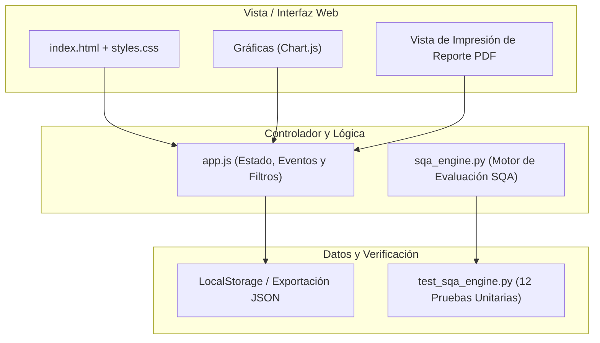

# Especificación de Diseño de Software (SDS) — QualityHub

- **Proyecto:** QualityHub
- **Responsable Técnico:** Paul Rivera Salas
- **Colaboradores de Diseño:** Elian Loera Garay, Diego Alvarado Díaz, Jesús Adrián Arias Delgado y Ricardo Parga

---

## 1. Arquitectura General
Para que el proyecto fuera fácil de mantener, rápido de probar y sin complicaciones al momento de presentarlo, decidimos dividir el diseño en dos partes que comparten exactamente las mismas reglas de negocio:

1. **Dashboard Web Interactivo (`src/index.html`, `src/app.js`, `src/styles.css`):**
   - Hecho con HTML5, Tailwind CSS y Chart.js para las gráficas.
   - Guarda el estado en `localStorage` del navegador para que los proyectos y técnicas que registres no se borren al recargar la página, e incluye un botón para restaurar los datos de demostración.
2. **Motor de Lógica y Evaluación SQA (`src/sqa_engine.py`):**
   - Implementa en Python las clases y fórmulas exactas del sistema para poder correr nuestra suite de pruebas unitarias (`tests/test_sqa_engine.py`) de manera automatizada tanto en local como en GitHub Actions.

---

## 2. Diseño de Clases y Estructura de Datos

En `src/sqa_engine.py` (y su equivalente en objetos JSON dentro de `src/app.js`), manejamos cuatro componentes principales:

### 2.1 `QualityMetrics`
Guarda los 5 indicadores de calidad de un proyecto y tiene su propio método `validate()` para impedir porcentajes mayores a 100 o números negativos:
- `unit_test_coverage` (`float`: 0.0 a 100.0)
- `ci_pass_rate` (`float`: 0.0 a 100.0)
- `critical_bugs` (`int`: >= 0)
- `sqa_compliance` (`float`: 0.0 a 100.0)
- `tech_debt_hours` (`float`: >= 0.0)

### 2.2 `SQATechniqueLog`
Representa cada actividad de aseguramiento de calidad aplicada:
- `id`: Identificador único (ej. `T-101`).
- `project_id`: A qué proyecto pertenece.
- `technique_type`: Solo acepta `Revisión Personal`, `Caminata (Walkthrough)`, `Pruebas Unitarias` o `Integración Continua`.
- `responsible`: Nombre del integrante que hizo o moderó la actividad.
- `date`: Fecha en formato `YYYY-MM-DD`.
- `status`: `Planificada`, `En Progreso` o `Completada`.
- `defects_found`: Cantidad de errores o hallazgos detectados.
- `notes`: Resumen de lo que se revisó o corrigió.

### 2.3 `MonitoredProject`
Agrupa la información general del proyecto (`id`, `name`, `period`, `lead`, `stack`), su objeto `QualityMetrics` y su lista de `techniques`. Valida con una expresión regular (`^\d{4}-[12]`) que el periodo tenga formato válido de semestre.

### 2.4 `QualityHubEngine`
Es el motor que concentra las operaciones:
- `register_project()`
- `get_projects_by_period()`
- `log_sqa_technique()`
- `calculate_sqa_compliance()`
- `calculate_health_score()`
- `classify_health_status()`
- `generate_health_report()`

---

## 3. Diseño del Algoritmo de Salud del Software (Health Score)

Para que el puntaje de salud de 0 a 100% fuera justo y reflejara la realidad de un proyecto, acordamos estos pesos en el equipo:

| Métrica | Peso | Cómo se calcula su aporte |
| :--- | :---: | :--- |
| **Cobertura de Pruebas Unitarias** | **30%** | `cobertura * 0.30` (Meta recomendada: `>= 80%`) |
| **Bugs Críticos Abiertos** | **25%** | `0 bugs = 100 pts`, `1 bug = 60 pts`, `2 bugs = 30 pts`, `>= 3 bugs = 0 pts` (multiplicado por `0.25`) |
| **Éxito en Integración Continua** | **20%** | `tasa_ci * 0.20` (Meta recomendada: `>= 90%`) |
| **Cumplimiento de Técnicas SQA** | **15%** | `porcentaje_completadas * 0.15` (Meta recomendada: `>= 85%`) |
| **Deuda Técnica Estimada** | **10%** | Si es `<= 8 horas` da los 100 pts; de 8 a 40 horas baja linealmente hasta 0 pts (multiplicado por `0.10`) |

### Regla de Semáforo (Decisión de Diseño Importante)
En nuestra primera caminata nos dimos cuenta de que un proyecto podía tener buen promedio general pero tener un bug crítico abierto. Por eso diseñamos la regla `classify_health_status()` así:
- **Saludable (Verde):** Puntaje `>= 85%` **y además** `0 bugs críticos`.
- **En Riesgo (Amarillo):** Puntaje entre `65% y 84.9%`, o bien puntaje `>= 85%` pero con `1 o 2 bugs críticos`.
- **Crítico (Rojo):** Puntaje `< 65%` o tener `3 o más bugs críticos` sin resolver.
