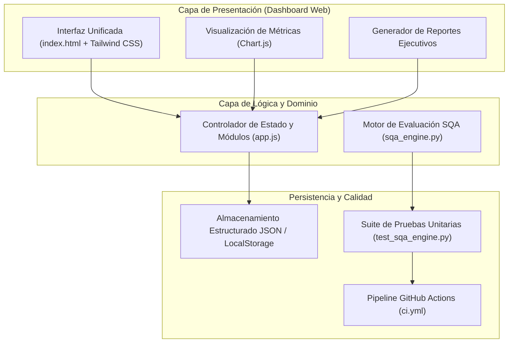

# Entregable 1: Definición, Arquitectura y Estrategia de SQA

- **Proyecto:** QualityHub — Centro de Control y Monitoreo de SQA
- **Fecha de Entrega:** Martes, 6 de octubre de 2026
- **Responsable de Proyecto:** Ricardo Parga
- **Arquitecto Técnico:** Paul Rivera Salas
- **Líder de QA:** Jesús Adrián Arias Delgado
- **Equipo de Desarrollo:** Elian Loera Garay, Diego Alvarado Díaz

---

## 1. Definición del Alcance Final

**QualityHub** es una aplicación web tipo dashboard diseñada para centralizar el monitoreo y control de Aseguramiento de la Calidad del Software (SQA) de múltiples proyectos de desarrollo organizados por periodos.

### Requisitos Funcionales Comprometidos (Alcance 100%)
1. **RF-01 Registro de Proyectos por Periodo:** Permitir registrar proyectos asociándolos a un periodo específico (ej. `2026-1`, `2026-2`), asignando nombre, líder responsable, stack tecnológico y descripción.
2. **RF-02 Seguimiento de Métricas de Calidad:** Capturar, actualizar y evaluar 5 métricas clave de calidad por proyecto frente a umbrales predefinidos (*Quality Gates*).
3. **RF-03 Gestión de Técnicas y Métodos de SQA:** Registrar y dar seguimiento a las actividades de SQA aplicadas a cada proyecto (Revisiones Personales, Caminatas/Walkthroughs, Pruebas Unitarias e Integración Continua), incluyendo fecha, evaluador, defectos encontrados y estado.
4. **RF-04 Generación de Reportes de Estado de Salud:** Calcular automáticamente el **Índice de Salud del Software (0–100%)**, mostrar diagnósticos visuales y generar reportes ejecutivos exportables/imprimibles sin errores.

---

## 2. Estrategia de Aseguramiento de Calidad (SQA) para el Desarrollo de QualityHub

Para garantizar la calidad y medir de manera continua el estado de salud de nuestro software durante todo su ciclo de vida, implementaremos un marco de Aseguramiento de la Calidad (SQA) que combina revisiones estáticas formales, verificación dinámica automatizada e integración continua. Como primer filtro de control, adoptamos las **revisiones personales** como práctica obligatoria previa a cualquier confirmación de código; en ellas, cada desarrollador audita minuciosamente sus propios módulos apoyándose en listas de comprobación (*checklists*) estandarizadas para prevenir errores de sintaxis, violaciones de convenciones y descuidos de lógica antes de compartirlos. Como técnica estática grupal, implementamos **caminatas (*walkthroughs*)**, sesiones técnicas estructuradas donde el autor expone paso a paso la arquitectura y flujo de sus componentes ante el equipo de trabajo, registrando formalmente hallazgos, sugerencias de refactorización y acuerdos de diseño mediante minutas de revisión. En el ámbito dinámico, desarrollamos suites de **pruebas unitarias** para verificar exhaustivamente el comportamiento y las condiciones límite de cada función y módulo crítico, estableciendo un umbral mínimo de cobertura de código. Finalmente, todo este esquema se orquestará mediante un flujo de **integración continua (CI)**, el cual ejecuta de forma desatendida las pruebas unitarias y validaciones de calidad en cada *Pull Request* antes de permitir la fusión con la rama principal. A través de este modelo, la salud del software se evalúa objetivamente mediante métricas como la densidad de defectos detectados en revisiones tempranas, la tasa de éxito de pruebas unitarias y la estabilidad de los despliegues, garantizando trazabilidad total de las decisiones de calidad en el repositorio.

### Catálogo de Métricas Definidas por el Equipo

| ID | Métrica | Fórmula / Medición | Umbral Saludable (Verde) | Umbral Riesgo (Amarillo) | Peso en Salud |
| :--- | :--- | :--- | :---: | :---: | :---: |
| **M-01** | Cobertura de Pruebas Unitarias | `(Líneas probadas / Total líneas) * 100` | `>= 80%` | `60% - 79%` | 30% |
| **M-02** | Éxito en Integración Continua | `(Pipelines exitosos / Total ejecuciones) * 100` | `>= 90%` | `75% - 89%` | 20% |
| **M-03** | Defectos Críticos Abiertos | Conteo absoluto de bugs severidad alta | `0` | `1 - 2` | 25% |
| **M-04** | Cumplimiento de Técnicas SQA | `(Técnicas completadas / Técnicas planificadas) * 100` | `>= 85%` | `65% - 84%` | 15% |
| **M-05** | Deuda Técnica Estimada | Horas hombre requeridas para corrección | `<= 8 hrs` | `9 - 20 hrs` | 10% |

---

## 3. Arquitectura del Sistema



---

## 4. Bocetos de la Interfaz (Wireframes)

### 4.1 Vista General del Centro de Control (Dashboard)
```text
+-----------------------------------------------------------------------------------+
| [Logo] QualityHub - Centro de Control SQA        Periodo: [ 2026-2 (Ago-Dic) v ]  |
+-----------------------------------------------------------------------------------+
| [Dashboard]  [1. Proyectos]  [2. Métricas QA]  [3. Técnicas SQA]  [4. Reportes]   |
+-----------------------------------------------------------------------------------+
| +-------------------+ +-------------------+ +-------------------+ +-------------+ |
| | Proyectos Activos | | Salud Promedio    | | Técnicas SQA      | | Bugs Crít.  | |
| |        4          | |      86.5%        | |   14 Aplicadas    | |      1      | |
| +-------------------+ +-------------------+ +-------------------+ +-------------+ |
|                                                                                   |
| +-----------------------------------------+ +-----------------------------------+ |
| | [Gráfico de Barras: Salud por Proyecto] | | [Gráfico Dona: Técnicas Aplicadas]| |
| |  - Sistema Nómina: 92% (Saludable)      | |  - Revisiones Personales (35%)    | |
| |  - Portal Clientes: 78% (En Riesgo)     | |  - Caminatas Walkthrough (25%)    | |
| |  - API Pagos: 95% (Saludable)           | |  - Pruebas Unitarias (25%)        | |
| |  - App Inventario: 64% (En Riesgo)      | |  - Integración Continua (15%)     | |
| +-----------------------------------------+ +-----------------------------------+ |
+-----------------------------------------------------------------------------------+
```

### 4.2 Vista de Registro de Proyectos y Seguimiento de Métricas
```text
+-----------------------------------------------------------------------------------+
| GESTIÓN DE PROYECTOS Y MÉTRICAS DE CALIDAD                    [+ Nuevo Proyecto]  |
+-----------------------------------------------------------------------------------+
| Proyecto         | Periodo | Cobertura | CI Pass | Bugs Crít. | Salud | Estado    |
|------------------+---------+-----------+---------+------------+-------+-----------|
| API Pagos Core   | 2026-2  |    91%    |   98%   |     0      |  95%  | SALUDABLE |
| Sistema Nómina   | 2026-2  |    85%    |   94%   |     0      |  91%  | SALUDABLE |
| Portal Clientes  | 2026-2  |    74%    |   82%   |     1      |  76%  | EN RIESGO |
+-----------------------------------------------------------------------------------+
```

### 4.3 Vista de Reporte Ejecutivo de Salud del Software
```text
+-----------------------------------------------------------------------------------+
| DICTAMEN DE SALUD DEL SOFTWARE                       [Imprimir / Exportar PDF]    |
| Proyecto Seleccionado: [ Portal Clientes v ]         Fecha: 03/11/2026            |
+-----------------------------------------------------------------------------------+
| ÍNDICE GLOBAL DE SALUD: 76 / 100  —  ESTADO: EN RIESGO MODERADO                   |
|                                                                                   |
| Desglose de Cumplimiento (Quality Gate):                                          |
| [!] Cobertura Unitaria: 74% (Meta >= 80%) -> Incumple (-6%)                       |
| [OK] Integración Continua: 82% (Aceptable)                                        |
| [!] Defectos Críticos Abiertos: 1 (Meta = 0) -> Requiere atención inmediata       |
|                                                                                   |
| Historial de Técnicas SQA Aplicadas al Proyecto:                                  |
| - 12/10/2026 | Revisión Personal | Autor: E. Loera  | 3 defectos corregidos       |
| - 18/10/2026 | Caminata (Walk.)  | Mod: J. Arias    | 2 mejoras arquitectónicas   |
+-----------------------------------------------------------------------------------+
```
